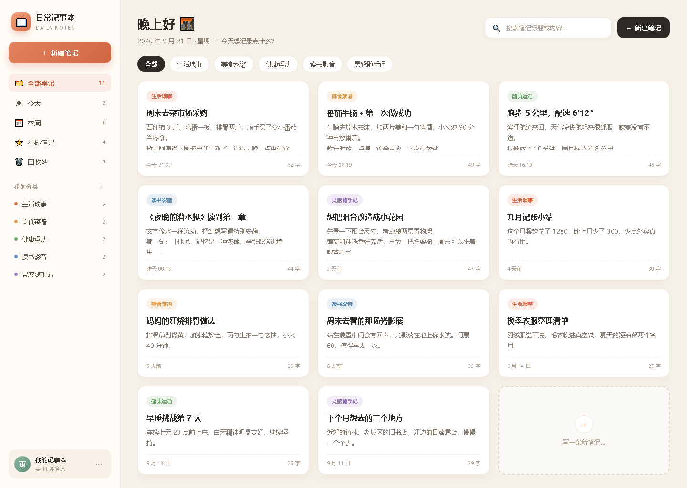
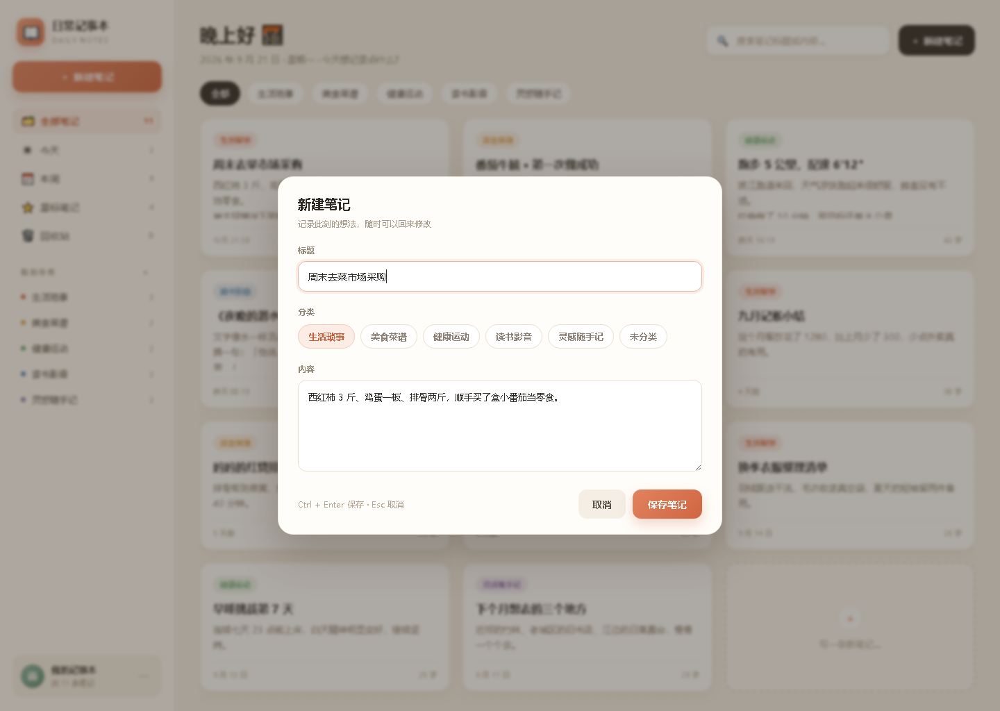
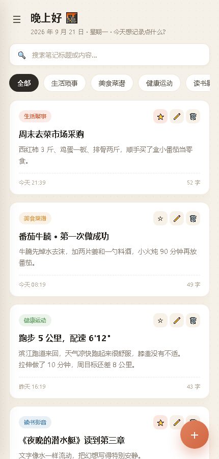

# 日常记事本

一个用来记录日常生活的本地网页应用。添加、编辑、删除、分类、星标、搜索、回收站都有，数据只存在你自己的电脑上——不注册、不联网、不上传。

项目由 **Codex（ChatGPT 客户端）** 生成：从一句需求描述开始，让它输出页面结构、样式和交互逻辑，再逐步调整细节。选它是因为这种「小而完整」的工具有明确的验收标准——打开就能用，用起来顺不顺手立刻知道。



## 为什么是本地存储

记事本这类工具最怕两件事：账号丢了笔记没了，和网络断了笔记打不开。所以这里刻意做成零后端：

- 数据存在浏览器的 `localStorage`，换设备就看不到，也意味着没人能远程拿走它
- 提供导出 / 导入 JSON 备份，迁移或换浏览器时手动搬一次
- 启动脚本只在本机 `127.0.0.1` 起一个静态服务，不对外暴露端口

## 怎么打开

**推荐：双击 `启动记事本.bat`**

会自动在 `8787`（被占用则顺延到 8800）起一个本地服务并打开浏览器。这种方式下浏览器会正常保存数据。

- 使用期间保留那个黑色小窗口，它就是后台提供页面的服务
- 关掉窗口或按 `Ctrl + C` 都不会丢笔记
- 没装 Python 3 时脚本会退化为直接打开 `index.html`，但部分浏览器在这个模式下不保存数据，页面上会有提示

也可以直接双击 `index.html`，只是存储行为依赖浏览器策略，不推荐。

## 功能

| 功能 | 说明 |
| --- | --- |
| 添加笔记 | 「新建笔记」填标题、选分类、写内容，`Ctrl + Enter` 保存，`Esc` 取消 |
| 编辑 | 点击任意卡片即可修改 |
| 删除 | 卡片右上角 🗑️，二次确认后进入回收站 |
| 回收站 | 30 天内可一键恢复，也可永久删除或清空 |
| 分类 | 侧边栏「我的分类」可增删改名，删分类不会删笔记 |
| 星标 | 重要笔记标 ⭐，集中查看 |
| 搜索 | 按标题、正文、分类名搜索，`/` 快捷聚焦 |
| 视图 | 全部 / 今天 / 本周 / 星标 / 回收站 |
| 备份 | 右下角「⋯」导出 JSON、导入备份、清空全部 |

## 文件结构

```
index.html              页面结构
assets/css/style.css    样式（暖阳纸感主题）
assets/js/app.js        全部逻辑与本地存储
design/                 设计稿与效果图
tools/serve.py          启动脚本用的本地静态服务
启动记事本.bat           推荐启动方式
```

## 数据安全提示

- 清理浏览器缓存 / 站点数据会清空笔记，动手前先用「⋯ → 导出备份」
- 换电脑、换浏览器时，导出 JSON 再导入即可
- 备份文件是明文 JSON，别放到公开位置

## 界面

| 新建笔记 | 移动端 |
| --- | --- |
|  |  |
